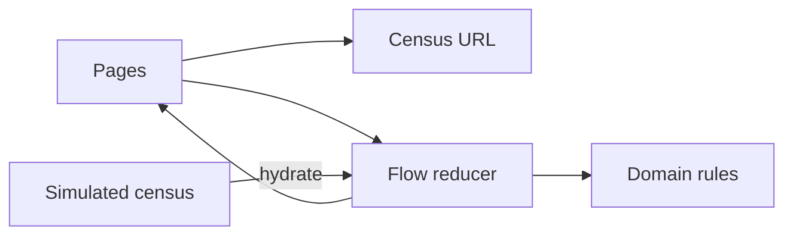

# Meridian Flow Desk

A patient-flow board for the charge nurse at Meridian General, a fictional hospital. It keeps one question in view: who is waiting, who can take them, which bed they can use, and which bed is being held by someone who could already leave.

## Setup

Requires Node 20 or newer.

```bash
npm install
npm run dev
```

Open the URL Vite prints, usually `http://localhost:5173`.

```bash
npm test
npm run build
```

The census is simulated. There is no backend. Refreshing the browser restores the afternoon snapshot and discards decisions made in the session.

### States worth opening

| What | How |
| --- | --- |
| Loading | Watch the first load. The census waits about 700ms. |
| Empty board | Open `/?demo=empty` in a fresh load. |
| Error | Open `/?demo=error` in a fresh load, then use Try again. The retry loads the normal census. |
| Empty search | On Census, search for a name that is not on the board. |

## The problem

Beds do not fail all at once. They fail in the gaps: a high-acuity patient sits in the waiting room while a bay is open, an admitted patient boards in the ED because the ward has not called, and two people who are ready to go home keep holding rooms. The charge nurse is the person who sees all of those at once.

This afternoon at Meridian:

- Elena Voss and Marcus Hale are ESI 2 and have waited past the 30-minute target, with open ED bays including resuscitation bed ED-01.
- Dr. Leah Kim is on duty with nobody in her care.
- Daniel Okoye is admitted to Med-Surg and still boarding in ED-05.
- Robert Diaz, Camille Brooks, and Samira Haddad are ready to leave and still holding beds.
- Dr. Marcus Webb is off shift and still has Walter Simmons.

## The user

Alex Chen, charge nurse for the emergency department, on the afternoon shift. Alex decides who gets the next physician and the next bed. Alex does not write orders. The board is an operations tool: status, assignment, and room turnover.

## Architecture



- **Domain** (`src/domain`) is the shared language: patients, rooms, physicians, and the status rules. The UI and the reducer both ask `treatmentGate` before treatment can start, so the button and the state machine cannot drift apart.
- **State** (`src/state/reducer.ts`) is the only place that changes a visit, a bed, or a shift. Actions carry the time and the actor, so the reducer stays pure and tests can pin a timestamp.
- **Server state** is one simulated fetch in `src/data/api.ts`. After hydrate, the session is local. A reload replaces the board; it does not patch individual actions. That is why the ready board has no Refresh control: a refresh would throw away the charge nurse's decisions.
- **Census filters live in the URL.** Search, status, service, acuity, sort, and grouping are `URLSearchParams`. A view can be shared, and the browser Back button restores it. The last census query is also remembered so a chart can return to the same slice.
- **Pages** are the four places Alex works: the afternoon board, the census, a single chart, and the room and physician boards.

## What you can do

- Read the board: waits past target, boarding, bed mix by unit, discharge holds, who is on duty.
- Search, filter, sort, and group the census.
- Open a chart and move the visit: triage, treatment, admission, discharge-ready, discharge.
- Assign a physician and a room. Occupied, cleaning, blocked, on-break, and off-shift choices are refused.
- Moving a patient sends the old room to cleaning. Marking it clean puts it back in the open pool.
- Register an arrival. Acuity is required and has no default.
- Discharge asks for confirmation because it closes the visit and releases the bed.
- Switch the board between day and night. The choice follows the system theme until Alex changes it.

## Technical decisions

- **TypeScript.** A wrong status or a missing bed should fail at compile time. The action union is exhaustive.
- **React Router.** The chart is a real route, and the census is a query string, not a pile of `useState`.
- **A reducer instead of a state library.** One module holds the invariants: you cannot start treatment without a physician and a room, you cannot take a dirty bed, and discharge always releases the previous room. At this size a store would add a dependency without a boundary.
- **No component library and no chart library.** The bed mix is a labeled bar, and the wait is a labeled meter. Both stay in the DOM, so the screen reader gets the same words as the graphic.
- **Native `<dialog>`.** The arrival form gets a focus trap, Escape, and a backdrop without a modal library.
- **Vitest and Testing Library.** The tests cover the rules that would cause a real mistake: blocked transitions, bed moves, the afternoon story, and the empty census.

## Assumptions and tradeoffs

- One signed-in user. There is no login and no conflict if two charge nurses edit the same bed.
- The visit is a straight line. Left-without-being-seen, transfers, and direct admits are not modeled. That keeps the state machine explainable; it is the first thing I would branch.
- `unit` is the admitting service. `room` is the physical place. Daniel is Med-Surg and still sitting in ED-05, which is how boarding shows up.
- Adult vital flags are display cues, not alarms. Children are not scored, because adult ranges would mark a normal child as unstable.
- The whole tree rerenders when the reducer updates. That is fine for a few dozen visits. Past a few hundred charts I would select slices, or move the board to a store with selectors, and virtualize the census.
- Styling is one tokenized stylesheet. I wanted one visual language and full control of the type and color. Feature CSS modules would be the next split if more people were editing it.
- I did not add a lint preset. `tsc --strict` and the tests are the gate. ESLint would still be worth adding in a longer engagement.
- The simulated latency is fixed. A real service would page, subscribe, and send one PATCH per action.

## Accessibility

- Skip link, landmarks, and a heading per page. The chart heading is focused when the route changes.
- Every control has a visible label. Status is a word, not a color alone. Over-target waits add the words "over target" for assistive tech.
- The arrival dialog is a native dialog. Discharge is a confirm step, not a single click.
- Buttons and fields meet a 44px target so the board is usable on a tablet at the desk.
- `prefers-reduced-motion` turns off the entrance and skeleton motion. `prefers-color-scheme` sets the first theme. Night board is an explicit toggle after that.
- Toasts use a polite live region.

## What I would build next

- A real API with optimistic updates and a version on each bed, so two coordinators cannot assign the same room.
- Roles: charge nurse, physician, and environmental services. EVS would only see rooms waiting on a clean.
- Left without being seen, transfer, and direct admission as explicit branches.
- An audit log of who moved which visit, already shaped by the timeline events.
- Virtualization once the census is a whole hospital, not one afternoon.
- Dragging a patient onto an open room, with the same reducer guards underneath the gesture.

## A short demo

1. Read the afternoon line. Two ESI-2 waits are past target, and three beds are held for discharge.
2. Open Elena Voss. Assign Dr. Kim and ED-01, begin triage, then start treatment. ED-01 flips to occupied.
3. Open Robert Diaz and complete the discharge. MS-04 goes to cleaning. Mark it clean from Rooms.
4. On Physicians, notice Dr. Webb is off shift and still has Walter Simmons.
5. Register an arrival and leave acuity unset once, to see why it is required.
